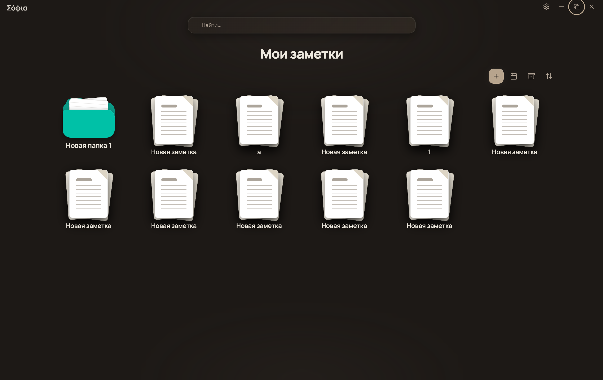
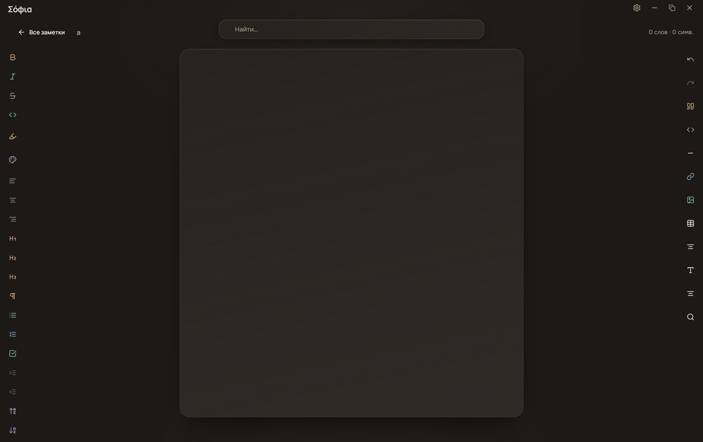
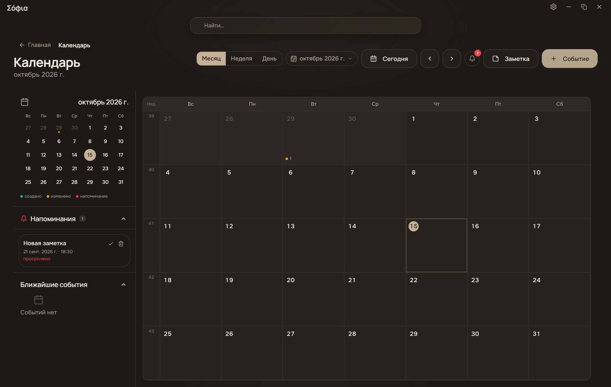
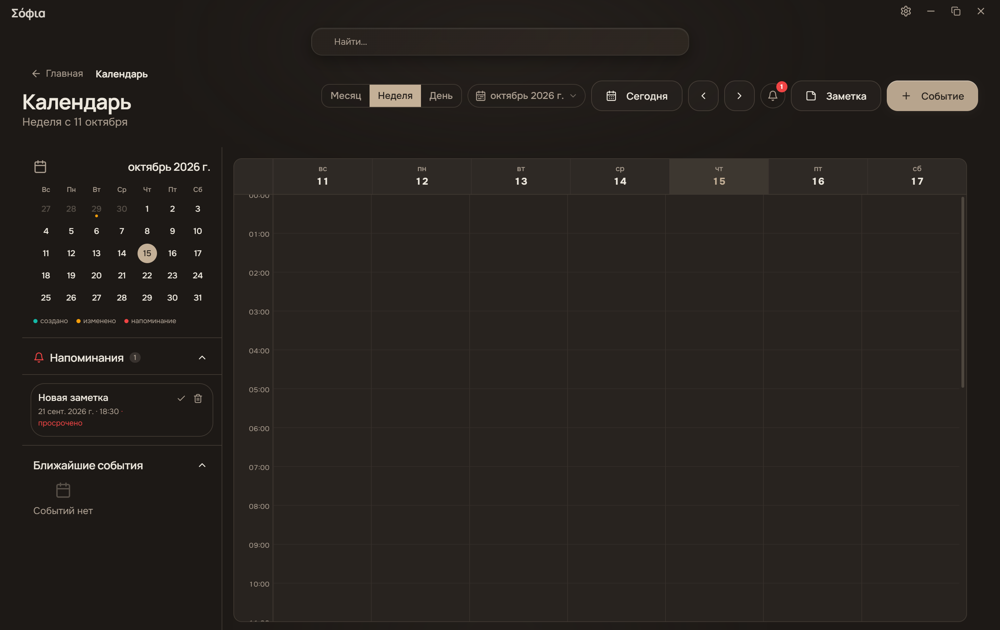
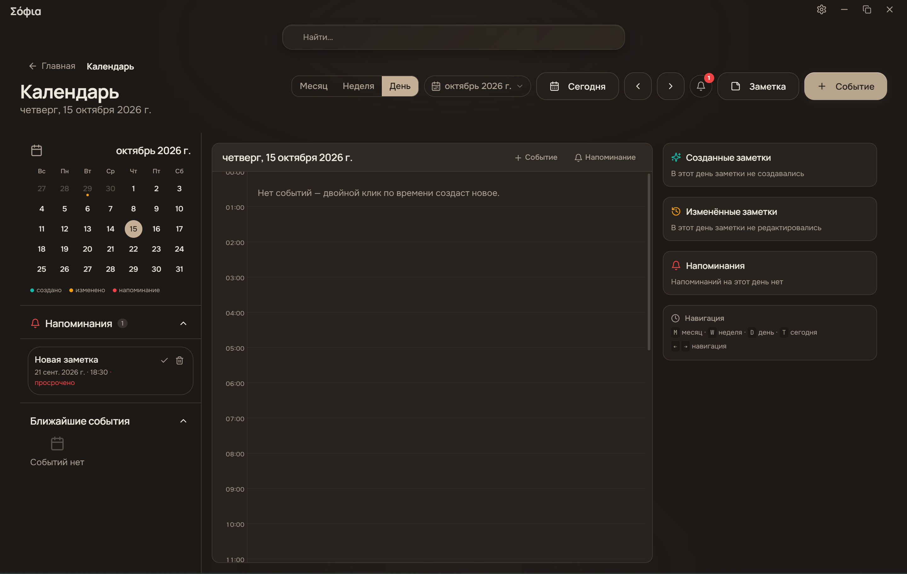
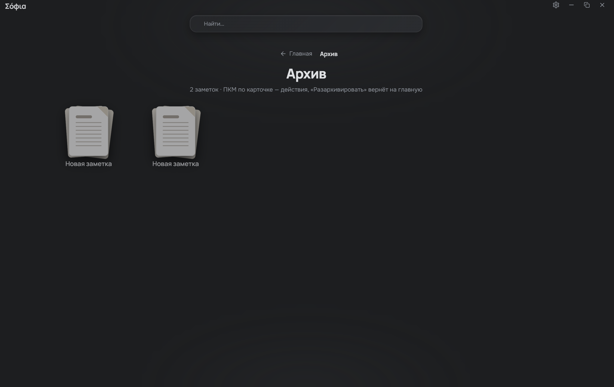
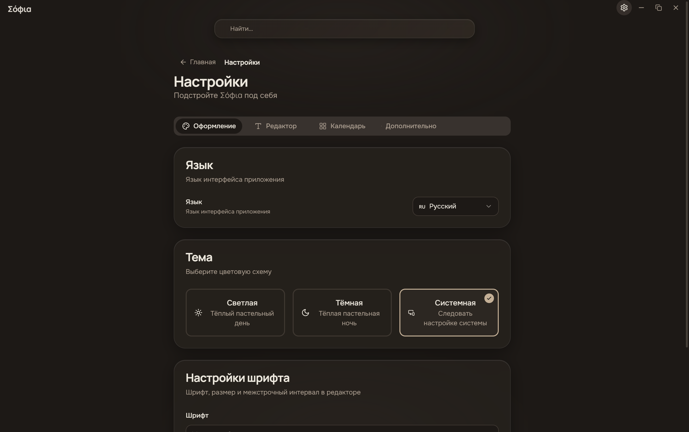

<div align="center">


# Σόφια · Sofia

**Локальное десктопное приложение для заметок с AI-транскрипцией, календарём и полнотекстовым поиском.**

Всё хранится на вашем устройстве. Без аккаунтов, без облака, без телеметрии.

[](https://github.com/klimenkod406/sofia/actions/workflows/ci.yml)
[](https://github.com/klimenkod406/sofia/releases)
[](LICENSE)

[](https://tauri.app)
[](https://react.dev)
[](https://www.typescriptlang.org)
[](https://www.rust-lang.org)
[](https://sqlite.org)
[](https://tailwindcss.com)

[English](README.en.md) · [Скачать](https://github.com/klimenkod406/sofia/releases) · [Сообщить об ошибке](https://github.com/klimenkod406/sofia/issues)

</div>

---

## 📸 Скриншоты

### Главная — папки и заметки

Сетка заметок и папок, глобальный поиск, сортировка и быстрый доступ к календарю, архиву и новой записи.



### Редактор

WYSIWYG-редактор на Tiptap: заголовки, списки, задачи, таблицы, код с подсветкой, цитаты, выравнивание и подсветка текста. Панели форматирования закреплены по бокам от полотна, счётчик слов и статистика — внизу.



### Календарь — месяц

Месячный вид с мини-календарём, легендой событий, боковой панелью напоминаний и списком ближайших событий. Создание события, привязка к заметке и повторения — в пару кликов.



### Календарь — неделя

Недельная сетка с почасовой разметкой: пересекающиеся события видно сразу, вертикальная прокрутка по времени.



### Календарь — день

Дневной вид дополнен сводкой: что было создано, что изменялось, какие напоминания запланированы. Быстрая навигация по горячим клавишам.



### Архив

Архивированные заметки хранятся отдельно от основного списка и возвращаются обратно в один правый клик.



### Настройки

Оформление, язык интерфейса, шрифты редактора, поведение календаря и дополнительные параметры — всё в одном месте.



---

## ✨ Возможности

### 📝 Заметки и редактирование

- **WYSIWYG-редактор** на Tiptap (ProseMirror) с поддержкой Markdown
- **Папки** — иерархические, с drag-and-drop и перетаскиванием заметок
- **Теги** — цветовая маркировка и фильтрация
- **Полнотекстовый поиск** — SQLite FTS5 с подсветкой совпадений
- **Экспорт** — Markdown, HTML, PDF, JSON, Plain Text
- **Импорт** — загрузка заметки из файла
- **Архив** — мягкое удаление с быстрым восстановлением
- **Дублирование и закрепление** — быстрые действия прямо из карточки заметки
- **История версий** — каждое изменение заметки сохраняется автоматически (последние 50)

### 📅 Календарь

- **Три вида** — месяц, неделя и день
- **События** — повторения, места, длительность, привязка к заметкам
- **Напоминания** — привязаны к заметкам, с отметкой «просрочено» и отложкой, счётчик в шапке
- **Сводка дня** — созданные и изменённые заметки рядом с повесткой

### 🤖 AI-возможности

- **Транскрипция** — распознавание речи из аудио и видео
- **Живая транскрипция** — потоковый режим, текст появляется во время записи
- **Анализ текста** — сокращение, исправление ошибок, улучшение формулировок, перевод, извлечение тезисов, генерация тегов
- **Чат-ассистент** — отдельный экран с контекстом по текущей заметке
- **Локальные модели** — GGUF через llama.cpp, без отправки данных в сеть
- **Облачные API** — OpenAI, Anthropic и любые совместимые endpoints
- **Менеджер моделей** — загрузка с прогрессом, проверка железа, подбор модели под CPU/GPU

### 🎨 Интерфейс

- **Тёмная и светлая темы** — с системной темой или вручную
- **Языки** — русский, английский, испанский, французский, немецкий
- **Типографика** — семейство шрифта, размер, межстрочный интервал
- **Свой тайтлбар** — frameless-окно в стиле macOS с треем и горячими клавишами
- **Адаптивная вёрстка** — от 1024×700 до широких мониторов

### ⚡ Производительность

- **Локальное хранилище** — SQLite, данные не покидают устройство
- **Ленивая загрузка** — страницы грузятся по требованию через `React.lazy`
- **Автосохранение** — настраиваемый интервал, асинхронная запись, интерфейс не блокируется
- **Индексы в базе** — оптимизированные запросы по заметкам, тегам и календарю
- **Фоновые задачи** — тяжёлые операции вне главного потока

---

## 🛠 Технологии

| Слой | Технологии |
|------|------------|
| Оболочка | Tauri 2 (Rust) — лёгкий десктопный рантайм |
| Frontend | React 18, TypeScript 5.6, Vite 5 |
| UI | Tailwind CSS 3.4, Radix UI, Lucide Icons |
| Редактор | Tiptap (ProseMirror), tiptap-markdown, lowlight |
| Состояние | Zustand, TanStack Query |
| База данных | SQLite (tauri-plugin-sql, sqlx), FTS5, Drizzle ORM |
| AI/ML | llama.cpp (GGUF), FunASR, Whisper.cpp — внешние процессы, без линковки ML-библиотек в процесс приложения |
| Тесты | Vitest, cargo test |

---

## 🚀 Запуск

### Требования

- **Node.js** 20+
- **Rust** 1.75+
- **Tauri CLI** — `cargo install tauri-cli`
- **Python** 3.8+ — для FunASR (опционально)
- **whisper-cli / llama-cli** — из соответствующих проектов, если нужны локальные модели

### Установка

```bash
git clone https://github.com/klimenkod406/sofia.git
cd sofia

npm install          # зависимости фронтенда
npm run tauri:dev    # запуск приложения с горячей перезагрузкой
```

### Команды разработки

```bash
npm run dev          # только Vite-сервер (порт 1420)
npm run tauri:dev    # приложение целиком
npm run tauri:build  # production-сборка с установщиком

npm run typecheck    # проверка типов
npm run lint         # ESLint
npm run lint:fix     # ESLint с автоисправлением
npm run format       # Prettier
npm run format:check # проверка форматирования

npm run test         # юнит-тесты фронтенда
npm run test:watch   # тесты в watch-режиме
npm run test:coverage

npm run db:generate  # сгенерировать миграции
npm run db:migrate   # применить миграции
npm run db:studio    # Drizzle Studio
```

---

## 📁 Структура проекта

```
sofia/
├── src/                        # Frontend (React + TypeScript)
│   ├── components/
│   │   ├── ui/                 # Базовые UI-примитивы
│   │   ├── home/               # Главная страница
│   │   ├── editor/             # Редактор и панели форматирования
│   │   ├── calendar/           # Календарь
│   │   ├── ai/                 # AI-чат и элементы анализа
│   │   └── settings/           # Настройки
│   ├── pages/                  # home, editor, calendar, archive, settings, ai-chat
│   ├── stores/                 # Zustand-сторы (notes, calendar, ai, settings, i18n)
│   ├── hooks/                  # Переиспользуемые хуки
│   ├── lib/                    # Локализация (i18n)
│   ├── styles/                 # Глобальные стили и темы
│   ├── types/                  # Общие типы
│   ├── App.tsx                 # Маршруты и layout
│   └── main.tsx                # Точка входа
├── src-tauri/                  # Backend (Rust)
│   └── src/
│       ├── commands/           # Tauri-команды (notes, folders, tags, calendar, ai, files)
│       ├── db/
│       │   ├── models.rs       # Модели данных
│       │   ├── repository/     # Паттерн Repository
│       │   └── migrations/     # SQL-миграции
│       ├── services/           # Бизнес-логика (export, backup, file_ops)
│       ├── ai/
│       │   ├── transcription.rs # Транскрипция
│       │   ├── live.rs          # Потоковая транскрипция
│       │   ├── analysis.rs      # Анализ текста
│       │   ├── llama_cpp.rs     # Локальные LLM
│       │   ├── funasr.rs        # FunASR
│       │   └── models.rs        # Менеджер моделей
│       └── main.rs
├── docs/screenshots/           # Скриншоты для README
├── public/                     # Статические ресурсы (favicon, интро)
└── package.json
```

---

## ⚙️ Конфигурация

### Переменные окружения

Создайте `.env` в корне проекта:

```env
# Облачные AI-провайдеры (необязательно)
OPENAI_API_KEY=sk-...
ANTHROPIC_API_KEY=sk-ant-...

# Пользовательский OpenAI-совместимый endpoint
OPENAI_BASE_URL=https://your-endpoint/v1

# Пути к локальным моделям (необязательно)
FUNASR_MODEL_DIR=/path/to/models
GGUF_MODEL_DIR=/path/to/gguf
```

### Тема и язык

Тема (светлая / тёмная / системная) и язык интерфейса меняются в приложении: **Настройки → Оформление**. Выбор сохраняется локально.

---

## 🧠 Архитектура AI

```
TranscriptionEngine
├── WhisperCppTranscriber — бинарник whisper-cli
├── FunASRTranscriber     — Python-процесс с FunASR
└── Backend::Api          — облачные провайдеры

LiveTranscriptionManager   — потоковая передача чанков и декодирование

AnalysisEngine
├── LlamaCppEngine     — локальные GGUF-модели (llama-cli / llama-server)
└── APIEngine          — OpenAI, Anthropic, совместимые endpoints

ModelManager
├── Загрузка моделей (HuggingFace, ModelScope) с прогрессом
├── Управление API-ключами
└── Определение железа (GPU / CPU) и подбор модели
```

Бэкенд выбирается по полю `backend` в конфигурации модели: FunASR — для китайского и английского, Whisper.cpp — для остальных языков, API — для облачных провайдеров. Локальные движки запускаются **дочерними процессами**, поэтому ML-библиотеки никогда не линкуются в GUI-процесс приложения.

---

## 🧪 Тестирование и CI

```bash
npm run test          # фронтенд
cd src-tauri && cargo test   # бэкенд
```

GitHub Actions прогоняет линтер, проверку типов, форматирование, юнит-тесты фронтенда и бэкенда, `cargo fmt`, `cargo clippy` и собирает приложение на **Ubuntu, Windows и macOS**.

---

## 📦 Сборка

```bash
npm run tauri:build
```

Инсталляторы появятся в `src-tauri/target/release/bundle/`:

| Платформа | Формат |
|-----------|--------|
| Windows | NSIS `.exe`, MSI |
| macOS | `.app`, `.dmg` |
| Linux | AppImage, `.deb` |

---

## 🤝 Contributing

1. Форкните репозиторий
2. Создайте ветку: `git checkout -b feature/amazing-feature`
3. Закоммитьте изменения: `git commit -m 'Add amazing feature'`
4. Отправьте ветку: `git push origin feature/amazing-feature`
5. Откройте Pull Request

Перед отправкой убедитесь, что проходят `npm run lint`, `npm run typecheck`, `npm run format:check` и `npm run test`.

---

## 📄 Лицензия

MIT — см. [LICENSE](LICENSE).

---

<div align="center">

**Σόφια** — мудрость в каждой заметке. 📖✨

</div>
